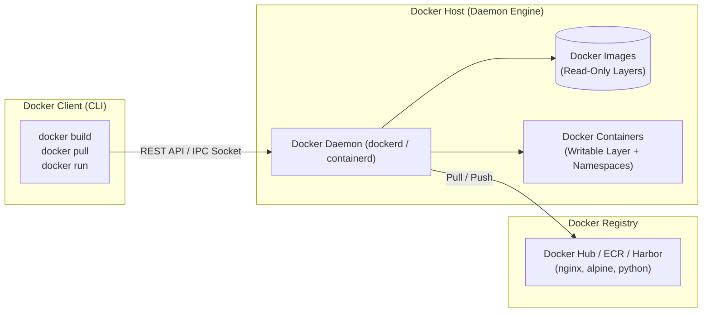

# Academic Research Report: Docker and WebAssembly (WASM)
**Institution:** Central University (Universidad Central)  
**Faculty / Degree:** Systems Engineering  
**Course:** Web Programming  
**Authors:**
- Jhostin Molina
- Sebastian Escuntar  

---

## Executive Summary / Resumen Ejecutivo
This academic inquiry investigates two transformative technologies in modern computing: **Docker** (Operating System-Level Containerization) and **WebAssembly** (Binary Code Format for Stack-Based Virtual Machines). Both technologies address software portability, isolation, and execution efficiency, but operate at distinct abstraction layers of the computing stack.

> **Resumen en Español:**  
> Este informe académico analiza en profundidad dos tecnologías clave de la computación moderna: **Docker** (virtualización a nivel de sistema operativo mediante contenedores) y **WebAssembly** (formato binario de bajo nivel para máquinas virtuales basadas en pila). Ambos resuelven problemas de portabilidad y rendimiento, pero operan en capas de abstracción distintas y complementarias.

---

# ========================================
# PART 1. DOCKER
# ========================================

## 1. WHAT IS DOCKER?

### 1.1. What is Docker?
Docker is an open-source platform that enables developers to automate the deployment, scaling, and management of applications inside lightweight, portable execution environments called **containers**. It packages the application source code alongside all of its libraries, system tools, binaries, and runtime dependencies.

### 1.2. What is its Main Purpose?
The primary purpose of Docker is to provide **environmental parity** across all stages of the software development lifecycle. By packaging software into standard units, Docker guarantees that an application runs identically regardless of differences between the developer's local machine, testing servers, staging environments, and production cloud clusters.

### 1.3. What Problem Does It Solve?
Docker solves the historical software engineering issue known as the **"It works on my machine!" problem**. Before Docker, subtle differences in operating system versions, installed libraries, system packages, path configurations, or CPU architectures caused applications to fail when moved from a developer's workstation to a production server. Docker eliminates this friction by encapsulating the entire user space of the operating system into a self-contained image.

### 1.4. What Are Containers?
A **container** is a standard unit of software that packages code and its dependencies so the application runs quickly and reliably from one computing environment to another. 
- Unlike Traditional Virtual Machines (VMs), containers do **not** bundle a full guest operating system or a virtual hardware abstraction layer (hypervisor).
- Containers share the host operating system's kernel.
- On Linux, containers are powered by native kernel primitives:
  - **Namespaces:** Provide isolation (PID for processes, NET for network interfaces, MNT for filesystem mount points, IPC for inter-process communication, and USER for user IDs).
  - **Control Groups (cgroups):** Enforce resource constraints and metering (CPU limits, RAM allocation, disk I/O, network bandwidth).
  - **Union Filesystems (OverlayFS):** Enable efficient, layered, copy-on-write storage.

### 1.5. Real-World Analogy
Consider the **intermodal maritime shipping container** invented by Malcolm McLean in 1956. Before standard shipping containers, cargo (barrels of wine, crates of fruit, sacks of grain) had to be loaded and unloaded individually by dockworkers, which was slow, dangerous, and caused damage. Standardized metal containers can be transported seamlessly across cargo ships, semi-trucks, and freight trains without opening or modifying the contents inside. Docker brings the exact same standardization to digital software: any software stack can be placed inside a Docker container, and any host system with Docker installed can run it immediately.

> **Explicación en Español para la Defensa:**  
> **¿Qué responder ante el profesor?**  
> "Docker no es una máquina virtual completa. Docker utiliza características nativas del kernel de Linux (llamadas *namespaces* para aislamiento y *cgroups* para limitar memoria y CPU) para crear una caja aislada llamada contenedor. Esto resuelve el clásico problema de *'en mi máquina sí funciona'*, garantizando que el código se ejecute exactamente igual en tu laptop con Windows o AlmaLinux que en un servidor en la nube de Amazon o Google."

---

## 2. HOW DOES DOCKER WORK?

### 2.1. Step-by-Step Execution Workflow
1. **Definition:** A developer authors a plain-text configuration file named `Dockerfile`, specifying the base operating system image, environment variables, commands to install dependencies, and the target application entrypoint.
2. **Build:** The developer executes `docker build`. The Docker Client sends the build context to the Docker Daemon, which parses the instructions layer by layer and produces an immutable **Docker Image**.
3. **Storage & Distribution:** The generated image can be pushed to an image **Registry** (such as Docker Hub, Quay.io, or AWS ECR) using `docker push`.
4. **Instantiate & Run:** On any target host, running `docker run` causes the Docker Daemon to check local cache, pull the image from the registry if missing, allocate namespaces and cgroups, create a thin writable container layer on top of the immutable image layers, and launch the application process.

### 2.2. Core Docker Components
- **Docker Client (`docker`):** The Command Line Interface (CLI) tool used by developers to communicate with the Docker Daemon via REST API calls over Unix domain sockets or named pipes (`npipe://` on Windows).
- **Docker Daemon (`dockerd` / `containerd`):** The long-running background service running on the host system. It listens for Docker API requests and manages Docker objects including images, containers, networks, and storage volumes.
- **Docker Images:** Read-only, immutable templates composed of multiple stacked filesystem layers. Each instruction in a `Dockerfile` adds a layer.
- **Docker Containers:** The live, runnable instances of Docker images. When a container is started, a thin read-write layer (the container layer) is added on top of the underlying read-only image layers.
- **Docker Registry:** A stateless, scalable server-side application that stores and distributes Docker images (e.g., Docker Hub, GitHub Packages, Amazon ECR).

### 2.3. Architecture Diagram


### 2.4. Practical Example: From Code to Running Container
1. You write a single HTML file: `index.html`.
2. You write a `Dockerfile` referencing `FROM nginx:alpine` and `COPY index.html /usr/share/nginx/html/index.html`.
3. Running `docker build -t my-web:1.0 .` creates an image containing the Alpine Linux root filesystem, the Nginx binary, and your HTML file.
4. Running `docker run -d -p 8080:80 my-web:1.0` instantiates a container, binds host port 8080 to container port 80, and starts the Nginx master process.

> **Explicación en Español para la Defensa:**  
> **Relación de componentes:**  
> - El **Cliente** es el comando que tú escribes (`docker run`).  
> - El **Daemon** es el motor que ejecuta el trabajo en segundo plano.  
> - La **Imagen** es la receta/plantilla estática de solo lectura (como una clase en POO).  
> - El **Contenedor** es la instancia viva en ejecución de esa imagen (como un objeto en POO).  
> - El **Registry** es la biblioteca en la nube donde descargas y compartes imágenes (como Docker Hub o GitHub).

---

## 3. WHERE IS DOCKER IMPLEMENTED?

### 3.1. Implementation Areas & Industrial Domains
- **Software Development:** Developers create reproducible local stacks (databases, queues, caches, APIs) using containers without cluttering their host operating system with conflicting database engines or runtimes.
- **DevOps & Continuous Integration / Continuous Deployment (CI/CD):** CI pipelines (GitHub Actions, GitLab CI, Jenkins) spin up clean, ephemeral Docker containers to run automated tests, compile source code, and deploy artifacts reliably.
- **Cloud Computing & Container Orchestration:** Modern hyperscale infrastructure relies on container orchestration engines, primarily **Kubernetes (K8s)**, AWS ECS, Google Cloud Run, and Azure Container Apps to automatically scale, heal, and load-balance containerized workloads.
- **Microservices Architecture:** Monolithic architectures are decomposed into hundreds of small, decoupled microservices. Each service (e.g., Auth, Payments, Catalog) runs in its own isolated container, communicating over lightweight HTTP/REST or gRPC protocols.

### 3.2. Real-World Corporate Examples
- **Netflix:** Deploys hundreds of thousands of containers daily to serve global video streaming recommendations, encoding pipelines, and user telemetry.
- **Spotify:** Packages its microservices into containers managed across distributed clusters to deliver real-time audio streaming.
- **Uber:** Uses containerized infrastructure to handle real-time geospatial matching, driver dispatching, and dynamic pricing calculations.

### 3.3. Execution Environments Supported
- **Linux Systems:** RHEL, AlmaLinux, Rocky Linux, Ubuntu, Debian, Fedora (native kernel execution).
- **Windows:** Windows 10/11 using WSL2 (Windows Subsystem for Linux) or native Windows Server containers.
- **macOS:** Via Docker Desktop using a lightweight Linux hypervisor utility VM.
- **Cloud Hyperscalers:** Amazon Web Services (AWS), Google Cloud Platform (GCP), Microsoft Azure, Oracle Cloud.
- **Edge & IoT Devices:** Raspberry Pi, NVIDIA Jetson, industrial gateways using ARM/ARM64 architectures.

> **Explicación en Español para la Defensa:**  
> **¿Dónde se usa Docker?**  
> "Docker se usa en todo el ciclo de vida del software: en las computadoras de los desarrolladores para levantar bases de datos en segundos; en los servidores de integración continua (CI/CD) para ejecutar pruebas automatizadas; y en producción a través de Kubernetes en la nube (AWS, Azure, GCP) para dar servicio a millones de usuarios simultáneos en empresas como Netflix y Spotify."

---

## 4. WHO CREATED DOCKER?

### 4.1. The Creator: Solomon Hykes
Docker was created by Franco-American software engineer **Solomon Hykes** alongside his core engineering team, including Sébastien Pahl and Jerome Petazzoni.

### 4.2. Company dotCloud
In 2008, Solomon Hykes founded **dotCloud** in Paris, France (later moving to San Francisco and joining the Y Combinator accelerator). dotCloud was a Platform-as-a-Service (PaaS) company competing with Heroku. To manage applications from thousands of customers efficiently on shared Linux servers, the dotCloud team engineered an internal orchestration engine based on Linux LXC (Linux Containers), AUFS (Another Union File System), and the Go programming language.

### 4.3. Public Presentation & Launch
In **March 2013**, at the **PyCon conference in Santa Clara, California**, Solomon Hykes stepped onto the stage and delivered a legendary 5-minute lightning talk demonstrating Docker to the public for the first time. During the demonstration, he open-sourced Docker under the Apache 2.0 license.

### 4.4. Historical Evolution & Pivot
The developer community's enthusiastic adoption of Docker was immediate and overwhelming. In **October 2013**, dotCloud officially rebranded the company to **Docker, Inc.**, pivoted away from its original PaaS offering, and concentrated entirely on the Docker open-source container engine and enterprise container ecosystem.

> **Explicación en Español para la Defensa:**  
> **Historia clave:**  
> "Docker nació como una herramienta interna de una empresa francesa llamada dotCloud (fundada por Solomon Hykes) que ofrecía alojamiento web. Para aislar las aplicaciones de sus clientes en un mismo servidor Linux crearon Docker. En marzo de 2013, en la conferencia PyCon de California, Solomon Hykes presentó Docker al mundo y lo liberó como código abierto. Tuvo tanto éxito que en octubre de 2013 la empresa cambió de nombre a Docker, Inc."

---

## 5. SIMPLE POC - DOCKER

### 5.1. Project Structure
Located in the project directory: `docker-poc/`
- `index.html`: Web page with the exact message `"Hello from Docker!"`.
- `Dockerfile`: Configuration based on `nginx:alpine`.

### 5.2. Source Code
**`Dockerfile`:**
```dockerfile
# Step 1: Base image from official Alpine Linux with Nginx
FROM nginx:alpine

# Step 2: Copy the custom static HTML website into the Nginx public web directory
COPY index.html /usr/share/nginx/html/index.html

# Step 3: Document that the container listens on port 80
EXPOSE 80
```

**`index.html`:**
```html
<!DOCTYPE html>
<html lang="en">
<head>
    <meta charset="UTF-8">
    <title>Docker POC - Academic Demo</title>
</head>
<body>
    <div class="card">
        <h1>Hello from Docker!</h1>
        <p>Proof of Concept successfully deployed using <strong>Docker</strong> and <strong>Nginx Alpine</strong>.</p>
    </div>
</body>
</html>
```

### 5.3. Step-by-Step Commands & Technical Explanations
1. **Build the Image:**
   ```powershell
   docker build -t docker-poc-web:1.0 ./docker-poc
   ```
   - *What happens:* Docker reads `Dockerfile`, fetches `nginx:alpine` from Docker Hub, creates an immutable filesystem layer containing `index.html`, and tags the image as `docker-poc-web:1.0`.

2. **Run the Container:**
   ```powershell
   docker run -d --name docker-poc-app -p 8080:80 docker-poc-web:1.0
   ```
   - *What happens:* Docker initializes a new container named `docker-poc-app`, creates network namespaces, routes host traffic from port `8080` to port `80` inside the container, and starts Nginx in background detached mode (`-d`).

3. **Verify with `docker ps`:**
   ```powershell
   docker ps --filter "name=docker-poc-app"
   ```
   - *Actual Result Verified:*
     `CONTAINER ID: 7bba7359d1b2 | IMAGE: docker-poc-web:1.0 | STATUS: Up | PORTS: 0.0.0.0:8080->80/tcp`

4. **Verify Application in Browser / Terminal:**
   ```powershell
   (Invoke-WebRequest -Uri "http://localhost:8080").StatusCode
   ```
   - *Actual Result Verified:* `200 OK`, returning the HTML page containing `"Hello from Docker!"`.

---

# ========================================
# PART 2. WEBASSEMBLY (WASM)
# ========================================

## 1. WHAT IS WEBASSEMBLY?

### 1.1. What is WebAssembly?
WebAssembly (abbreviated **Wasm**) is a binary instruction format for a stack-based virtual machine. It is designed as a portable compilation target for programming languages such as C, C++, Rust, and Go, enabling high-performance client-side and server-side code execution.

### 1.2. What is its Main Purpose?
The main purpose of WebAssembly is to enable **near-native execution performance on the web**. It works alongside JavaScript, allowing performance-critical modules (such as 3D graphics rendering, video encoding, physics simulation, cryptography, and complex mathematics) to run at speeds comparable to compiled native binaries.

### 1.3. What Problem Does It Solve?
WebAssembly solves the **performance ceiling and single-language limitation of the World Wide Web**:
1. **JavaScript Bottlenecks:** JavaScript is dynamically typed and interpreted/JIT-compiled at runtime. Complex calculations often suffer from garbage collection pauses, JIT de-optimizations, and slow parse times for large script files.
2. **Language Barrier:** For over 20 years, JavaScript was the only language natively supported by web browsers. Developers could not reuse existing codebases written in mature systems languages (C, C++, Rust). WebAssembly solves this by providing a universal binary target that all major browsers execute directly.

### 1.4. What is a `.wasm` Module?
A **`.wasm` module** is a pre-compiled, compact binary file containing bytecode structured into distinct sections:
- **Type Section:** Declares all function signature prototypes.
- **Import / Export Sections:** Defines symbols imported from or exported to the host environment (JavaScript).
- **Function / Code Sections:** Contains the actual binary bytecode instructions executed by the virtual machine.
- **Memory Section:** Defines the size and properties of the linear memory array allocated to the module.

### 1.5. Real-World Analogy
Consider a **dedicated graphics processing card (GPU) or mathematical coprocessor** inside a computer. The CPU and standard operating system handle user interface clicks and window menus (similar to JavaScript handling HTML DOM events). However, when heavy numerical tasks arise—such as calculating 3D matrix transformations or 4K video rendering—the CPU offloads that calculation to the specialized coprocessor (WebAssembly). The coprocessor executes the math at blistering speed and passes the result back to the user interface.

> **Explicación en Español para la Defensa:**  
> **¿Qué responder ante el profesor?**  
> "WebAssembly (WASM) no busca reemplazar a JavaScript, sino complementarlo. Es un formato binario compacto que permite compilar lenguajes como C, C++ o Rust para que corran dentro del navegador a velocidad casi nativa. Un archivo `.wasm` es un módulo binario compilado que el navegador valida y ejecuta de manera segura en una máquina virtual basada en pila."

---

## 2. HOW DOES WEBASSEMBLY WORK?

### 2.1. Step-by-Step Execution Workflow
1. **Authoring:** A programmer writes code in a compiled language (e.g., C function `add(a, b)`).
2. **Compilation:** A compiler toolchain (such as **Emscripten** or LLVM/Clang) parses the C code, performs intermediate optimizations (LLVM IR), and generates binary WebAssembly bytecode (`.wasm`) along with JavaScript glue code (`.js`).
3. **Fetching & Streaming:** The web browser requests the `.wasm` file over HTTP. Modern browsers compile the bytecode in parallel while the file is still downloading using `WebAssembly.instantiateStreaming()`.
4. **Validation & Sandbox Initialization:** The browser's Wasm runtime verifies that the bytecode adheres to strict type safety and control-flow integrity rules. It allocates a linear memory buffer (a raw contiguous array of bytes) isolated from the rest of the computer.
5. **Execution & Interoperability:** JavaScript invokes the exported WebAssembly function (`Module._add(10, 5)`), parameters are passed across the boundary, the Wasm stack engine calculates the result, and returns it to JavaScript to update the webpage DOM.

### 2.2. Core Components of WebAssembly
- **Source Code:** Systems programming languages (C, C++, Rust, Go) that provide manual memory control and predictable performance.
- **Compiler (Emscripten / LLVM):** Translates high-level source code into compact `.wasm` instructions.
- **WebAssembly Module (`.wasm`):** The compiled binary bytecode artifact.
- **WebAssembly Runtime:** The execution engine inside the browser (V8 in Chrome/Edge, SpiderMonkey in Firefox, JavaScriptCore in Safari) or standalone runtime (Wasmtime, Wasmer).
- **Linear Memory:** A continuous, resizable array of raw bytes represented as a JavaScript `ArrayBuffer`.
- **JavaScript Interoperability (WebAssembly JS API):** Methods such as `WebAssembly.compile`, `WebAssembly.instantiate`, and helper wrappers (`ccall`, `cwrap`) allowing bidirectional communication between JavaScript and Wasm.

### 2.3. Architecture Diagram
```mermaid
flowchart TD
    subgraph Development["1. Compilation Phase (Developer Host)"]
        Source["C / C++ / Rust Source Code\n(add.c)"]
        Compiler["Emscripten Toolchain (emcc / LLVM)"]
        Bytecode[("Compiled Binary\nadd.wasm (349 bytes)")]
        Glue["JavaScript Glue Code\n(add.js)"]
        Source --> Compiler
        Compiler --> Bytecode
        Compiler --> Glue
    end

    subgraph Browser["2. Runtime Execution Phase (Web Browser Engine)"]
        Fetch["HTTP Fetch / instantiateStreaming()"]
        Engine["Wasm Stack Machine / JIT\n(V8 / SpiderMonkey)"]
        Memory[("Linear Memory Sandbox\n(WebAssembly.Memory)")]
        JS["JavaScript Host Environment"]
        DOM["HTML DOM User Interface\n('10 + 5 = 15')"]

        Bytecode --> Fetch
        Fetch --> Engine
        Engine <--> Memory
        Glue --> JS
        JS <-->|Call _add(10, 5) / Return Sum| Engine
        JS -->|Render Result| DOM
    end
```

### 2.4. Practical Example: C to Browser Execution
1. In `add.c`, we declare:
   ```c
   int add(int a, int b) { return a + b; }
   ```
2. We compile using Emscripten:
   ```bash
   emcc add.c -O2 -s WASM=1 -s EXPORTED_FUNCTIONS="['_add']" -o add.js
   ```
3. In `index.html`, JavaScript executes:
   ```javascript
   const sum = Module._add(10, 5);
   ```
4. The browser's Wasm engine pushes `10` and `5` onto the Wasm evaluation stack, executes the `i32.add` instruction, pops the result `15`, and returns it directly to JavaScript in less than a millisecond.

> **Explicación en Español para la Defensa:**  
> **Paso a paso de cómo funciona:**  
> 1. Escribes tu lógica en C.  
> 2. Emscripten toma ese código C y lo compila a instrucciones binarias (`.wasm`).  
> 3. El navegador web descarga el `.wasm` mediante HTTP.  
> 4. El motor del navegador (como V8 en Chrome) verifica que el código sea seguro y lo compila a código de máquina del procesador.  
> 5. JavaScript llama a la función de C como si fuera una función normal de JS (`Module._add`) y muestra el resultado en pantalla.

---

## 3. WHERE IS WEBASSEMBLY IMPLEMENTED?

### 3.1. Implementation Areas & Industrial Domains
- **Web Browsers:** Client-side web applications running complex desktop-class productivity software.
- **Browser Gaming:** Porting 3D game engines (Unity WebGL, Unreal Engine, Godot) to run natively in browser tabs without plugins.
- **Image & Video Processing:** Real-time client-side video decoding, canvas manipulation, image filters, and computer vision.
- **Scientific Computing & Machine Learning:** Running client-side mathematical simulations, CAD modeling, and neural network inference (TensorFlow.js WebAssembly backend).
- **Server-Side & Cloud Computing:** Microservices, serverless functions, and plugin architectures running outside the browser via **WASI (WebAssembly System Interface)**.

### 3.2. Real-World Corporate Examples
- **Figma:** The collaborative interface design platform ported its C++ rendering engine to WebAssembly, dramatically cutting load times by 3x and handling complex vector canvases smoothly.
- **Adobe Photoshop Web:** Adobe compiled the full desktop C++ codebase of Photoshop into WebAssembly, enabling professional-grade image editing entirely inside Google Chrome.
- **Google Earth:** Migrated its massive multi-million line C++ 3D rendering codebase to WebAssembly to run seamlessly across all modern browsers.
- **Cloudflare Workers & Fastly:** Use server-side WebAssembly to execute serverless edge functions with sub-millisecond cold start times (orders of magnitude faster than traditional containers).

### 3.3. Execution Environments Supported
- **Web Browsers:** Google Chrome, Mozilla Firefox, Apple Safari, Microsoft Edge, Opera (Desktop and Mobile).
- **JavaScript Runtimes:** Node.js (via native `WebAssembly` global object), Deno, Bun.
- **Standalone Server Runtimes (WASI):** Wasmtime (Bytecode Alliance), Wasmer, WasmEdge, Lucet.
- **Edge Cloud Providers:** Cloudflare Workers, Fastly Compute, Fermyon Spin, AWS Lambda (via custom runtimes).

> **Explicación en Español para la Defensa:**  
> **¿Dónde se usa WebAssembly?**  
> "WebAssembly se usa tanto en el cliente como en el servidor. En la web lo usan herramientas gigantes como **Figma**, **Adobe Photoshop Web** y **Google Earth**, que migraron millones de líneas de C++ para que corran en el navegador sin instalar nada. En el servidor y la nube (como Cloudflare Workers y Fastly), se usa para funciones serverless ultrarrápidas porque arranca en microsegundos, mucho más rápido que un contenedor Docker."

---

## 4. WHO CREATED WEBASSEMBLY?

### 4.1. Creator: An Industry-Wide Consortium
Unlike technologies authored by a single engineer, WebAssembly was developed through an unprecedented collaboration among competing technology giants: **Mozilla, Google, Microsoft, and Apple**, coordinated under the **World Wide Web Consortium (W3C)**.

### 4.2. Role of Key Organizations
- **W3C (World Wide Web Consortium):** Established the **WebAssembly Working Group** and **WebAssembly Community Group (CG)** to formally govern, standardize, and ratify the language specification.
- **Mozilla:** Built the foundation through **asm.js** (an optimizable strict subset of JavaScript) and developed Emscripten under the leadership of Alon Zakai.
- **Google:** Contributed expertise from its Native Client (**NaCl / PNaCl**) research and integrated Wasm support into the V8 JavaScript engine.
- **Microsoft & Apple:** Collaborated in defining the binary opcode specification and implemented runtime support in Chakra (Edge) and JavaScriptCore (Safari).

### 4.3. Historical Timeline
- **June 2015:** WebAssembly was publicly announced as a joint initiative between Mozilla, Google, Microsoft, and Apple.
- **March 2017:** The **Minimum Viable Product (MVP)** was reached; cross-browser consensus was achieved, and Wasm was enabled by default across Chrome, Firefox, Safari, and Edge.
- **December 5, 2019:** The W3C officially designated WebAssembly as a **W3C Recommendation**. This made WebAssembly the **fourth official standard language of the Web**, joining HTML, CSS, and JavaScript.

### 4.4. Key Takeaway: Not a Single Individual
WebAssembly was not invented by one individual. It represents an intentional, multi-vendor consensus standard created to avoid the historical vendor lock-in wars of proprietary plugins (such as Adobe Flash, Microsoft Silverlight, and Java Applets).

> **Explicación en Español para la Defensa:**  
> **¿Quién creó WebAssembly?**  
> "Es fundamental aclarar ante el profesor que WebAssembly **NO fue creado por una sola persona**. Fue desarrollado de manera conjunta por las cuatro empresas tecnológicas más grandes de navegadores: **Mozilla, Google, Microsoft y Apple**, bajo la coordinación del consorcio **W3C**. Se anunció en junio de 2015 y en diciembre de 2019 el W3C lo declaró el cuarto lenguaje estándar oficial de la web, junto con HTML, CSS y JavaScript."

---

## 5. SIMPLE POC - WEBASSEMBLY

### 5.1. Project Structure
Located in the project directory: `webassembly-poc/`
- `add.c`: C source code exporting function `add(int a, int b)`.
- `add.wasm`: Compiled WebAssembly binary bytecode (349 bytes).
- `add.js`: Emscripten JavaScript runtime glue.
- `index.html`: Interactive user interface with inputs and calculate button.
- `style.css`: Clean, modern stylesheet.

### 5.2. Source Code
**`add.c`:**
```c
#include <emscripten.h>

EMSCRIPTEN_KEEPALIVE
int add(int a, int b) {
    return a + b;
}
```

**`index.html` (Excerpt of Interoperability):**
```html
<script>
    var Module = {
        onRuntimeInitialized: function() {
            document.getElementById('status').textContent = "✓ WebAssembly Runtime Ready";
            document.getElementById('calc-btn').disabled = false;
        }
    };

    function executeWasmAddition() {
        const val1 = parseInt(document.getElementById('num1').value, 10);
        const val2 = parseInt(document.getElementById('num2').value, 10);
        
        // Direct invocation of the exported C function in WebAssembly
        const sum = Module._add(val1, val2);
        
        document.getElementById('result').textContent = `${val1} + ${val2} = ${sum}`;
    }
</script>
<script src="add.js"></script>
```

### 5.3. Step-by-Step Commands & Technical Explanations
1. **Compile C into WebAssembly and JavaScript:**
   ```powershell
   docker run --rm -v "c:\Users\User\Docker_Web-Assembly\webassembly-poc:/src" emscripten/emsdk emcc add.c -O2 -s WASM=1 -s EXPORTED_FUNCTIONS="['_add']" -s EXPORTED_RUNTIME_METHODS="['ccall','cwrap']" -o add.js
   ```
   - *What happens:* Emscripten compiles `add.c` through LLVM, emits the compact binary `add.wasm` (349 bytes), and produces `add.js` to manage asynchronous binary downloading and memory setup.

2. **Run Local HTTP Server:**
   ```powershell
   python -m http.server 8000 --directory ./webassembly-poc
   ```
   - *Why this is mandatory:* Browsers enforce CORS security rules; attempting to open `index.html` via `file:///` causes an origin block. The HTTP server delivers the `.wasm` file with `Content-Type: application/wasm`.

3. **Verify Node.js CLI Execution:**
   ```powershell
   node -e "const m = require('./webassembly-poc/add.js'); m.onRuntimeInitialized = () => { console.log('10 + 5 =', m._add(10, 5)); };"
   ```
   - *Actual Result Verified:* `WASM test in Node.js: 10 + 5 = 15`.

4. **Verify Interactive Browser Execution:**
   - Navigated to `http://localhost:8000`.
   - Input A: `10`, Input B: `5`.
   - Clicked "Calculate with C / WebAssembly".
   - Result: `10 + 5 = 15` displayed on screen.

---

# ========================================
# PART 3. COMPARISON: DOCKER VS WEBASSEMBLY
# ========================================

## 1. Comparison Matrix

| Feature / Criteria | Docker | WebAssembly (WASM) |
| :--- | :--- | :--- |
| **Primary Purpose** | Package and run entire application environments (OS userland + code + dependencies) | High-performance execution of compiled binary code at near-native speed |
| **How It Works** | OS-level virtualization sharing host Linux kernel via namespaces and cgroups | Virtual stack-based machine executing sandboxed bytecode instructions |
| **Abstraction Level** | Operating system user space (filesystem, network stack, processes) | Process / Application runtime level (code execution & linear memory) |
| **Isolation Mechanism** | Kernel namespaces, cgroups, seccomp profiles, chroot | Capability-based memory sandbox (strictly isolated linear memory buffer) |
| **Startup Latency** | Milliseconds to seconds (hundreds of ms to initialize rootfs) | Sub-millisecond (microseconds to instantiate and call functions) |
| **Artifact Footprint** | Megabytes to Gigabytes (e.g., 20 MB - 1 GB+) | Kilobytes to Megabytes (e.g., 349 bytes - 20 MB) |
| **Execution Environment** | Linux host, Windows/Mac via VM, Kubernetes clusters | Web browsers, Node.js, standalone WASI runtimes (Wasmtime, Wasmer) |
| **Primary Strengths** | Runs any existing software stack unmodified; mature ecosystem and networking | Ultra-fast startup, tiny binary footprint, native web browser execution, memory safety |
| **Main Limitations** | Heavier memory overhead; slower startup; needs compatible host kernel | Low-level memory model; limited system APIs (WASI still evolving); no native UI |
| **Typical Applications** | Microservices, databases, legacy app packaging, CI/CD, cloud deployments | Web games, browser photo/video editing, CAD in browser, edge serverless functions |

---

## 2. Complementary Relationship (Why They Are Not Direct Substitutes)

Docker and WebAssembly are **not direct competitors; they solve different problems and complement each other**:

1. **Different Abstraction Targets:**
   - Docker virtualizes the **operating system environment**. If you need to run a complex PostgreSQL database, a Python Django app, an Nginx reverse proxy, and Redis together, Docker is the right tool.
   - WebAssembly virtualizes the **CPU instruction set**. It does not care about Linux distributions or system filesystems; it executes a compiled mathematical algorithm or game engine with maximum computational efficiency.

2. **The Solomon Hykes Perspective:**
   In March 2019, Solomon Hykes (the creator of Docker) famously tweeted:
   > *"If WASM+WASI existed in 2008, we wouldn't have needed to have created Docker. That's how important it is. Webassembly on the server is the future of computing. A standardized system interface was the missing link. Big win for @bytecodealliance."*
   Hykes explained that for many serverless applications, developers do not truly want an entire Linux operating system image; they simply want a secure, isolated sandbox to run compiled code with zero startup latency.

3. **Convergence (Docker + Wasm):**
   Today, the two technologies work together. Docker Desktop and Docker Engine officially support running WebAssembly workloads directly alongside Linux containers using `containerd` and Wasm runtimes (like WasmEdge, Wasmtime, and Spin). You can package a `.wasm` binary into an OCI container image and manage it using standard Docker commands (`docker run --runtime=io.containerd.wasmedge.v1`).

> **Explicación en Español para la Defensa:**  
> **¿Por qué NO son sustitutos directos?**  
> "Docker empaqueta todo un sistema operativo con sus dependencias (servidores, bases de datos, redes). WebAssembly empaqueta código compilado para que corra a nivel de procesador en un sandbox seguro.  
> No compiten, se complementan: de hecho, hoy en día Docker puede ejecutar módulos de WebAssembly directamente a través de *containerd* y *WasmEdge*. WASM aporta arranque en microsegundos y archivos de pocos kilobytes, mientras que Docker aporta toda la infraestructura de red, almacenamiento y gestión empresarial."

---

# ========================================
# PART 4. ACADEMIC REFERENCES
# ========================================

1. **Docker Official Documentation:**  
   Docker Inc. (2026). *Docker Documentation: Get Started & Core Concepts*.  
   URL: https://docs.docker.com/

2. **Open Container Initiative (OCI):**  
   Linux Foundation (2024). *OCI Image and Runtime Specifications*.  
   URL: https://opencontainers.org/

3. **Docker Historical Presentation (PyCon 2013):**  
   Hykes, S. (2013). *The future of Linux Containers*. PyCon US 2013, Santa Clara, CA.  
   Recording & Slides: https://www.youtube.com/watch?v=wW9CAH9nSLs

4. **WebAssembly Official Specification & Community:**  
   W3C WebAssembly Working Group (2019–2026). *WebAssembly Core Specification (W3C Recommendation)*.  
   URL: https://www.w3.org/TR/wasm-core-1/  
   Official Portal: https://webassembly.org/

5. **MDN Web Docs (Mozilla Developer Network):**  
   Mozilla Foundation (2026). *WebAssembly Concepts and Guide*.  
   URL: https://developer.mozilla.org/en-US/docs/WebAssembly

6. **Emscripten Compiler Toolchain Documentation:**  
   Zakai, A. et al. (2026). *Emscripten: An LLVM-to-WebAssembly Compiler*.  
   URL: https://emscripten.org/

7. **Bytecode Alliance & WASI:**  
   Bytecode Alliance (2026). *WASI: The WebAssembly System Interface*.  
   URL: https://bytecodealliance.org/

---

# ========================================
# PART 5. DEFENSE GUIDE & PROFESSOR QUESTIONS
# ========================================

### Ten Possible Questions the Professor Could Ask (Q&A)

#### Q1: What is the main difference between a Docker Container and a Virtual Machine (VM)?
- **Answer (English):** A Virtual Machine virtualizes physical hardware through a hypervisor and runs a complete, heavy guest operating system with its own kernel. A Docker container shares the host operating system's kernel and uses Linux namespaces and cgroups to isolate processes, making containers much faster and lighter.
- **Defensa en Español:** Una máquina virtual emula hardware completo e instala un sistema operativo pesado con su propio kernel. Un contenedor comparte el kernel del sistema anfitrión y solo aísla los procesos con namespaces y cgroups, consumiendo mucha menos RAM y arrancando en segundos.

#### Q2: What are Linux namespaces and cgroups, and why are they critical for Docker?
- **Answer (English):** Namespaces provide isolation by giving each container its own private view of system resources (process IDs, network interfaces, filesystem mounts). Control Groups (cgroups) provide resource governance by limiting and monitoring how much CPU, memory, and disk I/O a container can consume.
- **Defensa en Español:** Los *namespaces* proporcionan aislamiento visual (para que el contenedor crea que está solo en la máquina y tenga sus propios procesos y red), y los *cgroups* establecen límites de consumo (para que un contenedor no consuma más CPU o memoria de la permitida).

#### Q3: Why is the `nginx:alpine` image preferred over a standard Ubuntu image in Docker?
- **Answer (English):** Alpine Linux is a security-oriented, ultra-minimalist Linux distribution based on musl libc and busybox. The `nginx:alpine` image is approximately 23 MB in size, compared to Ubuntu-based images which often exceed 150 MB. This reduces download times, minimizes attack surface, and saves storage.
- **Defensa en Español:** Alpine Linux es una distribución mínima y segura. Ocupa solo ~23 MB frente a los más de 150 MB de Ubuntu, lo que agiliza la descarga, optimiza el almacenamiento y reduce vulnerabilidades de seguridad.

#### Q4: Why is WebAssembly often described as running at "near-native" speed?
- **Answer (English):** WebAssembly is pre-compiled into a compact binary format that maps closely to modern hardware machine architectures. Unlike JavaScript, which requires dynamic parsing, profiling, and JIT recompilation, WebAssembly bytecode can be validated and translated to native CPU instructions in a single, predictable pass.
- **Defensa en Español:** Porque es código binario prediseñado para mapearse directamente a las instrucciones de los procesadores modernos. No requiere el pesado análisis de tipos dinámicos ni la recolección de basura de JavaScript, por lo que el navegador lo compila a código máquina en un solo paso predecible.

#### Q5: Can WebAssembly completely replace JavaScript in the web browser?
- **Answer (English):** No. WebAssembly was intentionally designed to complement JavaScript, not replace it. JavaScript excels at DOM manipulation, event handling, and high-level application coordination, while WebAssembly handles computationally intensive algorithms and heavy processing.
- **Defensa en Español:** No. WebAssembly no manipula el DOM directamente; fue creado para trabajar en equipo con JavaScript. JavaScript maneja la interfaz de usuario y los eventos, y le pasa a WebAssembly las tareas numéricas pesadas.

#### Q6: Why did our WebAssembly POC require a local HTTP server instead of opening the HTML file directly?
- **Answer (English):** Modern browsers enforce strict Cross-Origin Resource Sharing (CORS) and security policies on the `file:///` protocol, blocking asynchronous fetching of binary files. Furthermore, WebAssembly streaming compilation requires the server to send the specific MIME type `Content-Type: application/wasm`.
- **Defensa en Español:** Los navegadores bloquean por seguridad la carga de binarios locales mediante `file:///`. Además, el compilador streaming del navegador exige que el archivo se sirva con el encabezado HTTP oficial `Content-Type: application/wasm`.

#### Q7: What does the `EMSCRIPTEN_KEEPALIVE` macro do in our C code?
- **Answer (English):** By default, optimizing compilers perform Dead Code Elimination (DCE) to delete functions that are not called by `main()`. `EMSCRIPTEN_KEEPALIVE` instructs the compiler to retain the function in the final binary and add it to the WebAssembly module's export table so JavaScript can invoke it.
- **Defensa en Español:** Evita que el compilador borre la función durante la optimización. Le ordena a Emscripten que mantenga la función en el binario `.wasm` y la exporte para que JavaScript pueda llamarla.

#### Q8: What did Solomon Hykes mean when he tweeted that WASM on the server is the future of computing?
- **Answer (English):** He recognized that many modern cloud workloads (like serverless functions) only need secure process isolation and fast execution, not an entire Linux operating system. WebAssembly with WASI provides security, sandboxing, and instant microsecond startup without the overhead of container images.
- **Defensa en Español:** Se refería a que muchas tareas en la nube (como funciones serverless) no necesitan un sistema operativo Linux entero, sino solo un entorno seguro y aislado donde ejecutar código. WASI permite ese aislamiento arrancando en microsegundos.

#### Q9: What is WASI (WebAssembly System Interface)?
- **Answer (English):** WASI is a standardized modular system interface that allows WebAssembly programs to run outside the browser (on servers, desktops, or edge nodes) by providing secure, capability-based access to operating system features like files, sockets, and clocks.
- **Defensa en Español:** Es la interfaz estándar del sistema que permite a WebAssembly ejecutarse fuera del navegador (en servidores o Linux) de forma segura, permitiéndole interactuar con archivos, red y reloj del sistema operativo mediante un modelo basado en permisos estrictos.

#### Q10: How can Docker and WebAssembly be used together in modern DevOps?
- **Answer (English):** Docker now includes native support for WebAssembly via `containerd` shims (such as `runwasi` and WasmEdge). Developers can build `.wasm` binaries, package them inside standard OCI container images, and run them with `docker run` using minimal memory and sub-millisecond startup times.
- **Defensa en Español:** Docker ya soporta WebAssembly de manera nativa mediante herramientas como `runwasi`. Podemos crear un binario `.wasm`, empaquetarlo en una imagen de contenedor estándar y gestionarlo con comandos de Docker, obteniendo lo mejor de ambos mundos: portabilidad estándar y arranque ultrarrápido.

---

### Screenshots & Verification Checklist for Student Submission
Use this checklist when taking screenshots to submit as evidence to your professor:

1. **Docker Proof of Concept (`docker-poc`):**
   - [ ] Terminal running `docker build -t docker-poc-web:1.0 ./docker-poc` showing successful image build.
   - [ ] Terminal running `docker ps` showing container `docker-poc-app` up on port `0.0.0.0:8080->80/tcp`.
   - [ ] Web browser opened at `http://localhost:8080` displaying `"Hello from Docker!"`.

2. **WebAssembly Proof of Concept (`webassembly-poc`):**
   - [ ] Terminal showing directory files: `add.c`, `add.wasm` (349 bytes), and `add.js`.
   - [ ] Terminal running the local HTTP server (`python -m http.server 8000`).
   - [ ] Web browser opened at `http://localhost:8000` showing Input A: `10`, Input B: `5`, and Calculated Result: `10 + 5 = 15`.
   - [ ] Browser Developer Tools (Console tab) showing: `[WebAssembly Execution] add(10, 5) = 15`.
